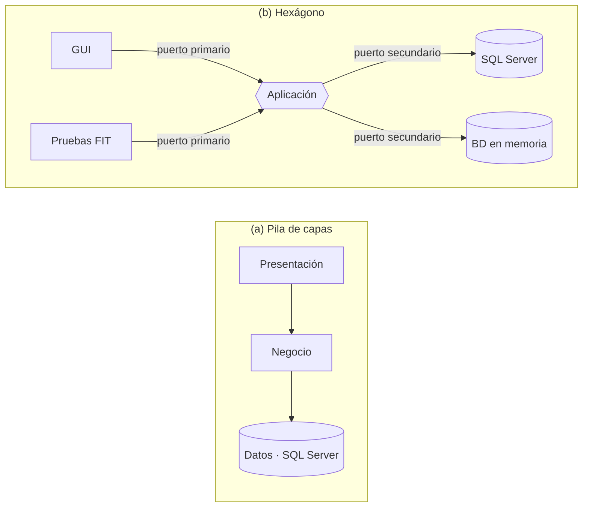
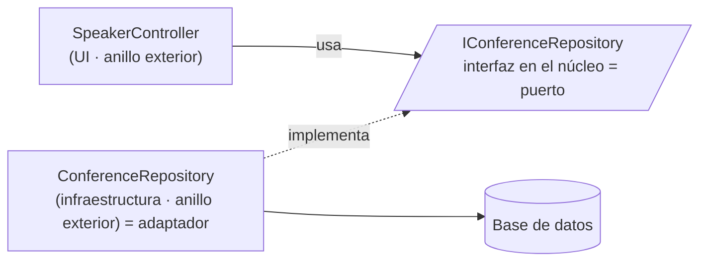

# P2: Simetría del Hexágono vs. Jerarquía de Capas

**Integrante:** Heily Rodríguez Rodríguez
**Issue:** #3
**Rama:** pregunta/p2-simetria-hexagono

> **Convención de citas:** los artículos web no tienen paginación. Cockburn (2005) se cita por sección, p. ej. (Cockburn, 2005, «Nature of the Solution»). La serie de Palermo se cita por entrega: 2008a = parte 1, 2008b = parte 2, 2008c = parte 3.

---

## Respuesta

### Problema conceptual que resuelve la simetría del hexágono

Hexagonal y Onion persiguen lo mismo, aislar el núcleo de negocio, y el propio Palermo reconoce que ambas comparten la premisa de externalizar la infraestructura y escribir código adaptador para no acoplarse a ella (Palermo, 2008a). Lo que cambia es el dibujo, y el dibujo importa porque transmite una idea de cómo se organiza el sistema. Cuando una arquitectura se dibuja como una pila de capas, el dibujo sugiere un **orden de importancia**: la interfaz de usuario queda arriba y la base de datos abajo, como si fuera el cimiento sobre el que se apoya todo. Con esa imagen, que la lógica de negocio dependa de la base de datos parece lo normal. Cockburn explica que este dibujo aparece porque muchas aplicaciones solo se comunican con dos cosas: el usuario y la base de datos. Pero tiene dos problemas. Primero, en la práctica nadie respeta las líneas que separan las capas, y la lógica de negocio acaba repartida entre ellas. Segundo, si la aplicación se comunica con más de dos cosas, ya no cabe en una sola columna (Cockburn, 2005, «Nature of the Solution»). Palermo llega a lo mismo por otro camino: si se redibuja la N-Capas tradicional como círculos, se ve que toda la aplicación gira alrededor del acceso a datos (Palermo, 2008c).

El hexágono cambia la pregunta: ya no importa qué está arriba y qué está abajo, sino **qué está dentro de la aplicación y qué está fuera** (Figura 1). Cockburn observa que los problemas con la interfaz de usuario y con la base de datos tienen la misma causa: la lógica de negocio está mezclada con el código que se comunica con el exterior (Cockburn, 2005, «Motivation»; «Nature of the Solution»). Por eso el hexágono los trata igual. La interfaz de usuario, las pruebas y la base de datos son, todos, elementos externos que se conectan a la aplicación. Onion se acerca a esta idea, porque pone la interfaz de usuario, la infraestructura y las pruebas en el mismo anillo exterior y deja claro que la base de datos «no es el centro» (Palermo, 2008a). La diferencia es que Onion sigue ordenando por niveles lo que hay *dentro* del núcleo, mientras que el hexágono se fija sobre todo en la frontera entre dentro y fuera.

*Figura 1. De la pila de capas al hexágono: en (a) la posición marca una jerarquía; en (b) todos los actores externos están al mismo nivel y se conectan por puertos. Elaboración propia a partir de Cockburn (2005, «Nature of the Solution»).*

### Traducción de «Puerto y Adaptador» a las interfaces internas de Onion

En la Arquitectura Hexagonal, un **puerto** es la «puerta» por la que la aplicación conversa con el exterior para un fin concreto, y se define como una interfaz o API. Un **adaptador** es la pieza que conecta una tecnología concreta, como SQL Server o una pantalla, a ese puerto (Cockburn, 2005, «Nature of the Solution»). Onion convierte esta idea en una regla sencilla: las capas de dentro definen las interfaces y las capas de fuera las implementan, de modo que las dependencias siempre apuntan hacia el centro (Palermo, 2008c). El ejemplo más claro es el **repositorio**, la pieza que guarda y recupera los datos. Su interfaz se coloca en el anillo que rodea al modelo de dominio, y la clase que de verdad accede a la base de datos se coloca en el borde. Además, la interfaz se diseña según lo que necesita el núcleo, no según la tecnología que habrá detrás (Palermo, 2008a). Dicho con el vocabulario de Cockburn, la interfaz del repositorio es un **puerto secundario** y su implementación, un **adaptador secundario** (Figura 2).

Palermo lo muestra con su aplicación CodeCampServer. El controlador de la interfaz, `SpeakerController`, no usa directamente la clase que accede a la base de datos, sino la interfaz `IConferenceRepository`, que está en el núcleo. La clase `ConferenceRepository` implementa esa interfaz desde fuera, y un contenedor de inversión de control (IoC) se encarga de crearla y entregársela al controlador en tiempo de ejecución (Palermo, 2008b). Cockburn hace lo mismo en su ejemplo: la clase `Discounter` recibe en su constructor un `RateRepository`, que puede ser la base de datos real o una simulada en memoria (Cockburn, 2005, «Sample Code»). Los dos autores apoyan este mecanismo en el principio de inversión de dependencias (Palermo, 2008a; Cockburn, 2005, «Related Patterns»). La diferencia es que Onion se centra sobre todo en el lado de la infraestructura, ya que cualquier capa externa puede llamar directamente a una interna (Palermo, 2008c). El hexágono, en cambio, trata igual los dos lados: lo que pone en marcha la aplicación y lo que la aplicación utiliza.

*Figura 2. Puerto y adaptador en Onion: la interfaz vive en el núcleo y su implementación en el borde; todas las dependencias apuntan hacia el centro. Elaboración propia a partir de Palermo (2008a; 2008b).*

### Por qué el hexágono no tiene seis lados por una razón numérica

Cockburn aclara que el número seis no tiene ningún significado. Eligió un hexágono para tener espacio donde dibujar todos los puertos y adaptadores que hagan falta, algo que un dibujo de capas en una sola columna no permite. Con esa forma quiere resaltar dos cosas: la diferencia entre dentro y fuera, con todos los puertos de la misma naturaleza, y que la aplicación tiene un número concreto de puertos distintos (Cockburn, 2005, «Nature of the Solution»). De hecho, considera que el número de puertos, normalmente entre dos y cuatro, es «en gran medida una cuestión de gusto» (Cockburn, 2005, «How Many Ports?»). Que el hexágono tenga seis lados no significa que la aplicación tenga seis puertos.

Lo que sí importa es que en un hexágono **ningún lado está por encima de otro**. Todos los lados son iguales, así que la posición deja de indicar importancia, que es justo lo que ocurría en la pila de capas. Por eso Cockburn propone olvidar «por un momento» las diferencias entre izquierda y derecha o entre arriba y abajo (Cockburn, 2005, «Nature of the Solution»). Más adelante sí distingue dos lados. A la izquierda pone lo que pone en marcha la aplicación, los **puertos primarios**, como la interfaz de usuario o las pruebas. A la derecha pone lo que la aplicación utiliza, los **puertos secundarios**, como la base de datos. Pero esa distinción depende de quién empieza la conversación, no de cuál es más importante (Cockburn, 2005, «The Left-Right Asymmetry»). En resumen, el hexágono elimina la jerarquía y solo conserva la diferencia que importa: lo que está dentro de la aplicación y lo que está fuera.

---

## Notas de diseño

- **Se matiza la premisa de que Onion es una representación «de capas apiladas».** Onion usa anillos concéntricos y comparte con Hexagonal la oposición dentro/fuera (Palermo, 2008a). El propio Palermo muestra que la forma del dibujo puede ser cualquiera, porque lo que cambia es la estructura (Palermo, 2008c). Por eso el contraste se plantea con la pila de la N-Capas y con la jerarquía interna de Onion.
- **La correspondencia entre las clases de CodeCampServer y los puertos y adaptadores es una interpretación propia.** Palermo solo afirma que Hexagonal y Onion comparten la premisa de externalizar la infraestructura y escribir código adaptador (Palermo, 2008a).
- **Las dos figuras son de elaboración propia** y se dibujan con TikZ en `solucion.tex`, como texto real. No hay imágenes rasterizadas.
- **Se citan las partes 2 y 3 de Palermo**, además de la parte 1 que figura en `core.bib`. Sus entradas se declaran en `investigacion/p2-hexagonal-onion/fuentes.bib` (issue #4) y no se repiten en `referencias.bib`, para no duplicar claves. No se citan los comentarios de lectores del final de la parte 3.
- **La respuesta se limita a Cockburn y Palermo**, las dos fuentes del issue.

---

## Referencias citadas

- Cockburn, A. (2005). *Hexagonal Architecture (Ports and Adapters)*. HaT Technical Report 2005.02. https://alistair.cockburn.us/hexagonal-architecture/. Secciones «Motivation», «Nature of the Solution», «Sample Code», «The Left-Right Asymmetry», «How Many Ports?» y «Related Patterns».
- Palermo, J. (2008a, 29 de julio). *The Onion Architecture: part 1*. https://jeffreypalermo.com/2008/07/the-onion-architecture-part-1/
- Palermo, J. (2008b, 30 de julio). *The Onion Architecture: part 2*. https://jeffreypalermo.com/2008/07/the-onion-architecture-part-2/
- Palermo, J. (2008c, 4 de agosto). *The Onion Architecture: part 3*. https://jeffreypalermo.com/2008/08/the-onion-architecture-part-3/
